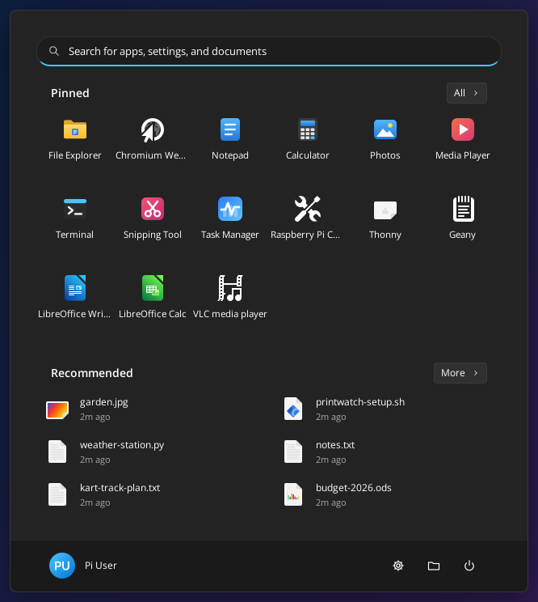
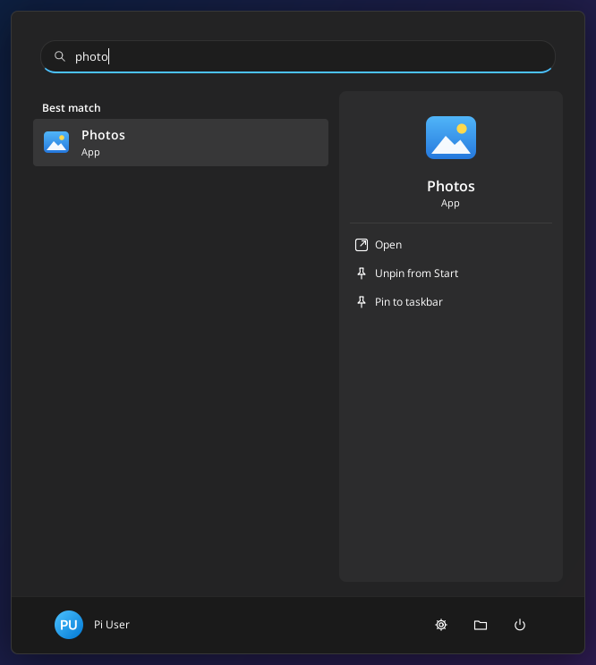
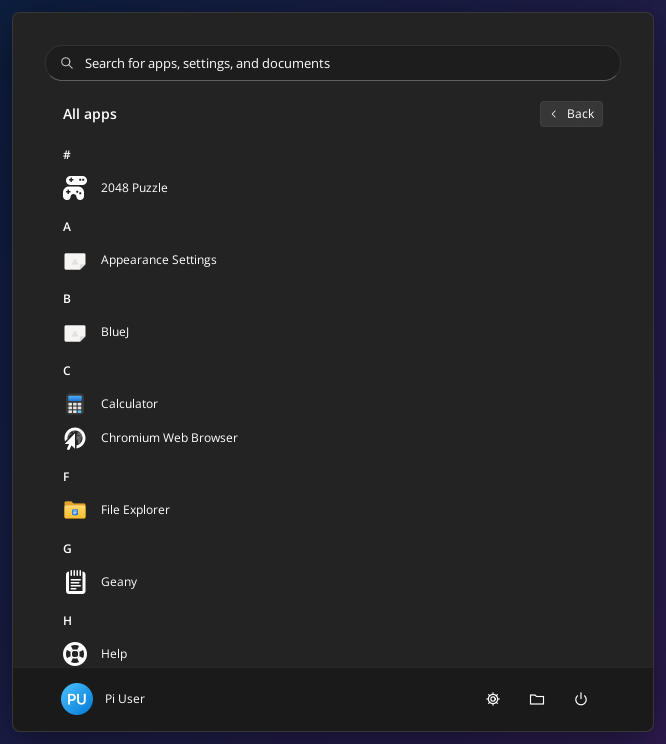
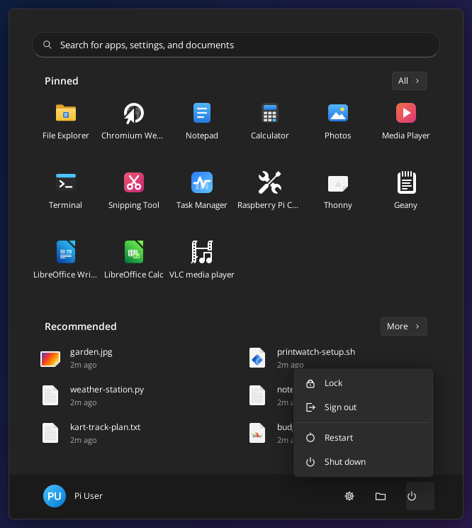

# pi-start

A Windows 11 style Start menu app for the Raspberry Pi (built for the Pi 5, works on other Pis running Raspberry Pi OS). Native GTK app with the Windows 11 dark look, made to match [pi-explorer](https://github.com/wvfouram/pi-explorer) and [pi-taskmgr](https://github.com/wvfouram/pi-taskmgr).



## Features

- **Replaces the raspberry menu**: the taskbar button becomes Start, and the **Super key** opens it
- **Search** as you type for apps, settings and files in your home folder, with a Best match and a details pane (Open, Pin to Start, Pin to taskbar, Open file location)
- **Pinned** apps grid, 18 per page, scroll for more pages. Right-click to unpin, move to front or pin to the taskbar
- **All apps** list A to Z; click a letter to jump
- **Recommended** files you opened recently, with More for the full list
- **Power** button with Lock, Sign out, Restart and Shut down, plus Settings and File Explorer buttons
- Opens instantly (it loads in the background at login); Esc or a click outside closes it
- Typing as soon as it opens goes straight into search, Up/Down and Enter pick a result





## Install

In a terminal on the Pi (as your normal user, not with sudo):

```
git clone https://github.com/wvfouram/pi-start.git && bash pi-start/install.sh
```

Then click the new **Start** button on the taskbar, or press the **Super** key.

Uninstalling puts the raspberry menu button and the old Super key action back.

To update later:

```
cd ~/pi-start && git pull && bash install.sh
```

## Keyboard shortcuts

| Keys | Action |
|---|---|
| Super | Open / close Start |
| Type | Search |
| Up / Down, Enter | Pick and open a search result |
| Esc | Clear search / go back / close |

## Uninstall

```
bash pi-start/uninstall.sh
```

## License

MIT
